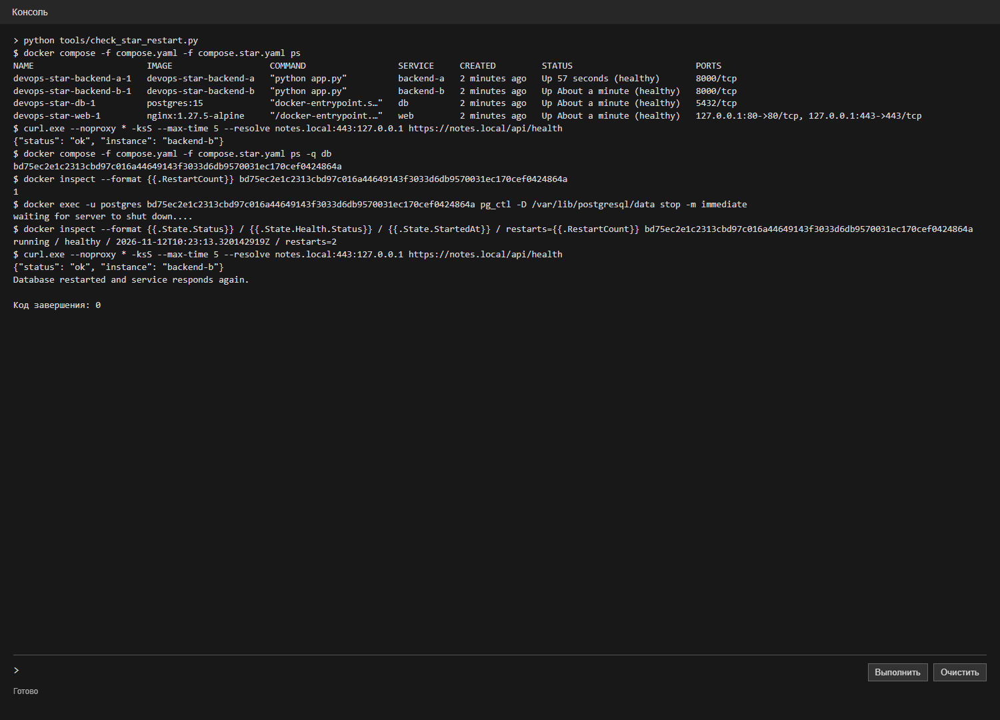
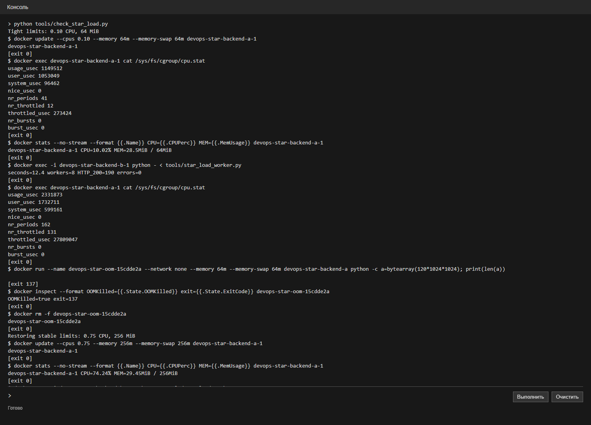
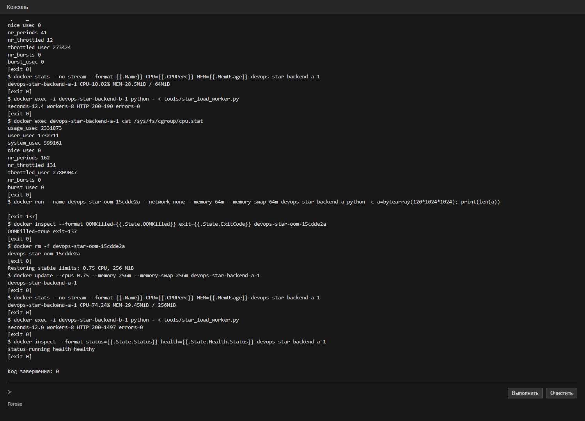

# Лабораторная работа 2 со звёздочкой. Устойчивый стек

ИСУ 504560, К3239

Продолжил работу с сервисом заметок из лабы 2. Проверил восстановление после остановки PostgreSQL и работу под ограничениями CPU и памяти.

## Настройка

К основному `compose.yaml` добавил [compose.star.yaml](compose.star.yaml). Для сервисов указал `restart: unless-stopped`, проверки состояния и лимиты. Бэкенд при запуске ждёт готовности базы, а второй экземпляр ждёт готовности первого. Для nginx добавил проверку страницы через HTTPS.

Запускал отдельным проектом, чтобы не затронуть другие контейнеры:

```powershell
./setup-local.ps1
$env:COMPOSE_PROJECT_NAME='devops-star'
docker compose -f compose.yaml -f compose.star.yaml up -d --build
```

Основные лимиты: по 0,75 CPU и 256 МиБ для базы и каждого бэкенда; для nginx — 0,5 CPU и 128 МиБ. Лимит памяти вместе со swap равен лимиту памяти контейнера.

## Восстановление базы

Проверил ответ `/api/health`, затем остановил PostgreSQL изнутри контейнера через `pg_ctl ... stop -m immediate`. Это аварийное завершение процесса, а не `docker stop`: при ручной остановке Docker не обязан автоматически запускать контейнер снова. Дождался `healthy` и ещё раз обратился к API.

В выводе счётчик перезапусков базы изменился с 1 на 2, а API вернул `status: ok`. Бэкенд переподключился к базе.



[Полный вывод](evidence/live-star-restart.txt) · [Скрипт проверки](tools/check_star_restart.py)

## Нагрузка и лимиты

Для нагрузки запустил восемь потоков из второго бэкенда: они 12 секунд обращались к `/api/health` первого бэкенда. Сначала временно ограничил первый контейнер до 0,10 CPU и 64 МиБ. `docker stats` показал около 10% CPU, а счётчик `nr_throttled` вырос с 12 до 131. За 12,4 секунды получил 190 ответов 200, ошибок не было.

Проверку нехватки памяти провёл отдельно в временном контейнере из того же образа: при лимите 64 МиБ и таком же лимите памяти вместе со swap процесс попытался выделить 120 МиБ. Он завершился с кодом 137, Docker показал `OOMKilled=true`. Это искусственная нагрузка на память, а не результат HTTP-запросов.



Вернул для бэкенда 0,75 CPU и 256 МиБ и повторил HTTP-нагрузку. За 12 секунд получил 1497 ответов 200, ошибок не было; контейнер остался `healthy`. Это результат одного короткого прогона на моём компьютере.



[Полный вывод](evidence/live-star-load.txt) · [Скрипт проверки](tools/check_star_load.py) · [Нагрузочный клиент](tools/star_load_worker.py)
