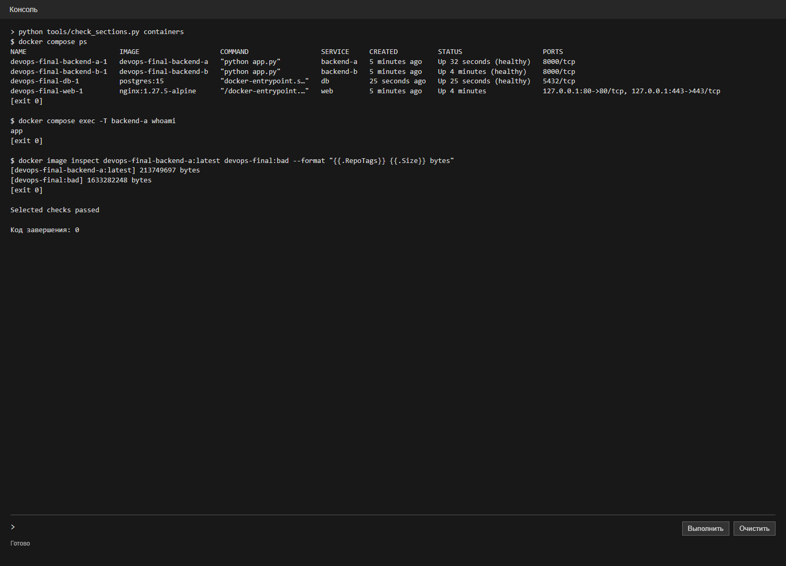
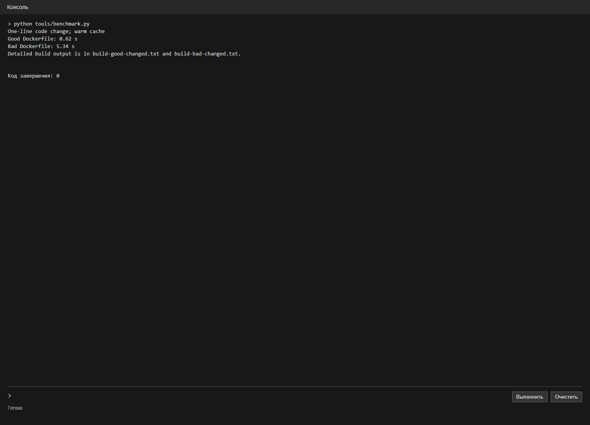
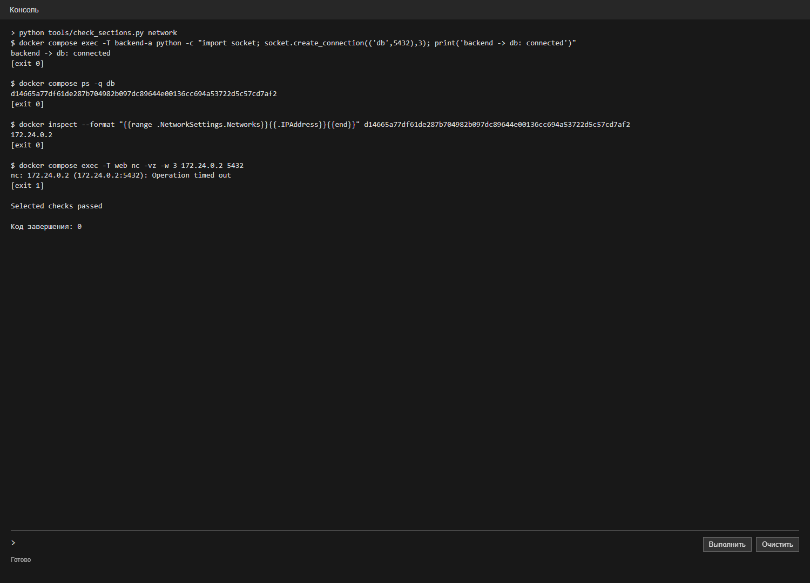
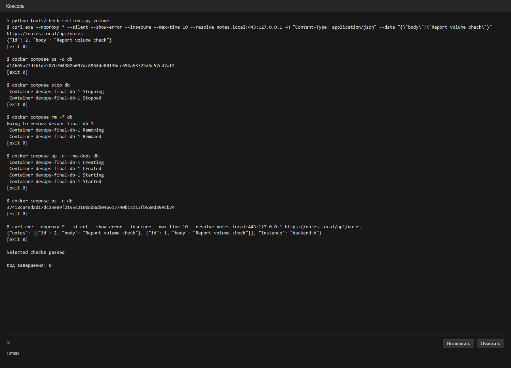

# Лабораторная работа 2. Docker

ИСУ 504560, К3239

Взял сервис заметок из лабы 0. Через Docker Compose запускаются nginx, два экземпляра приложения на Python и PostgreSQL. Команды запуска есть в [README](README.md).

## Dockerfile

Сделал [плохой Dockerfile](Dockerfile.bad) и [исправленный](Dockerfile). В плохом варианте использовал полный образ Python, скопировал весь проект до установки зависимостей и оставил запуск от root. В исправленном варианте использовал slim-образ с указанной версией, разделил сборку на этапы и добавил пользователя `app`. Сначала устанавливаются зависимости из `requirements.txt`, потом копируется код. Ещё добавил healthcheck. Через [.dockerignore](.dockerignore) исключил локальные файлы, отчёты и снимки из контекста сборки.

### Dockerfile.bad

```dockerfile
FROM python:3.12
WORKDIR /app
COPY . .
RUN pip install --no-cache-dir 'psycopg[binary]'
ENV PORT=8000 BIND_HOST=0.0.0.0
EXPOSE 8000
CMD ["python", "app.py"]
```

### Dockerfile

```dockerfile
FROM python:3.12.8-slim-bookworm AS dependencies
WORKDIR /build
COPY requirements.txt .
RUN pip install --no-cache-dir --prefix=/install -r requirements.txt

FROM python:3.12.8-slim-bookworm
RUN useradd --system --create-home app
WORKDIR /app
COPY --from=dependencies /install /usr/local
COPY app.py index.html ./
USER app
ENV PORT=8000 BIND_HOST=0.0.0.0
EXPOSE 8000
HEALTHCHECK --interval=15s --timeout=3s --retries=3 CMD python -c "import urllib.request; urllib.request.urlopen('http://127.0.0.1:8000/api/health', timeout=2)"
CMD ["python", "app.py"]
```

## Compose и размер образов

В [compose.yaml](compose.yaml) описаны `web`, `backend-a`, `backend-b` и `db`. Compose ждёт готовности базы перед запуском бэкенда. Поднял сервис командой:

```powershell
$env:COMPOSE_PROJECT_NAME='devops-final'
./setup-local.ps1
docker compose up -d --build
docker build -f Dockerfile.bad -t devops-final:bad .
```

Конфигурация Compose:

```yaml
name: devops-labs

services:
  db:
    image: postgres:15
    environment:
      POSTGRES_USER: labuser
      POSTGRES_PASSWORD: ${DB_PASSWORD:?Run setup-local.ps1 first}
      POSTGRES_DB: notes
    volumes:
      - notes_data:/var/lib/postgresql/data
    networks: [database]
    healthcheck:
      test: ["CMD-SHELL", "pg_isready -U labuser -d notes"]
      interval: 5s
      timeout: 3s
      retries: 10

  backend-a:
    build: .
    environment:
      DATABASE_URL: postgresql://labuser:${DB_PASSWORD:?Run setup-local.ps1 first}@db:5432/notes
      INSTANCE_ID: backend-a
    depends_on:
      db:
        condition: service_healthy
    networks: [web, database]

  backend-b:
    build: .
    environment:
      DATABASE_URL: postgresql://labuser:${DB_PASSWORD:?Run setup-local.ps1 first}@db:5432/notes
      INSTANCE_ID: backend-b
    networks: [web, database]
    depends_on:
      db:
        condition: service_healthy
      backend-a:
        condition: service_healthy

  web:
    image: nginx:1.27.5-alpine
    ports:
      - "127.0.0.1:80:80"
      - "127.0.0.1:443:443"
    volumes:
      - ./nginx.conf:/etc/nginx/nginx.conf:ro
      - ./index.html:/srv/site/index.html:ro
      - ./404.html:/srv/site/404.html:ro
      - ./docs:/srv/docs:ro
      - ./second:/srv/second:ro
      - ./admin:/srv/admin:ro
      - ./certs:/etc/nginx/certs:ro
      - ./auth:/etc/nginx/auth:ro
    depends_on: [backend-a, backend-b]
    networks: [web]

volumes:
  notes_data:

networks:
  web:
  database:
    internal: true
```

Проверил контейнеры, пользователя и размеры образов:



`whoami` вернул `app`. Размер исправленного образа получился 213 749 697 байт, плохого - 1 633 282 248 байт.

## Пересборка после изменения кода

Прогрел кеш, изменил одну строку в копии приложения и повторно собрал оба образа. Исправленный вариант пересобрался за 0.62 с, плохой - за 5.34 с. Это по одному измерению на этом компьютере; время зависит от кеша и системы. В журнале исправленной сборки шаг установки зависимостей отмечен `CACHED`, а в плохом варианте установка повторилась после изменения кода.



[Журнал исправленной сборки](evidence/build-good-changed.txt) · [журнал плохой сборки](evidence/build-bad-changed.txt) · [скрипт замера](tools/benchmark.py).

## Проверка сетей

В Compose две сети: `web` соединяет nginx с бэкендами, а внутренняя `database` - бэкенды с PostgreSQL. Из бэкенда подключение к базе прошло. Из контейнера nginx обращение к IP базы завершилось `Operation timed out` с кодом 1.



## Проверка тома

Добавил запись через API, остановил и удалил контейнер PostgreSQL, затем создал его заново и дождался готовности базы. ID контейнера изменился, а запись осталась в ответе API: том `notes_data` не удалялся вместе с контейнером.



Итог: сервис запускается через Compose; проверил размер и пересборку образов, доступ к базе из разных сетей и сохранение данных в томе.
