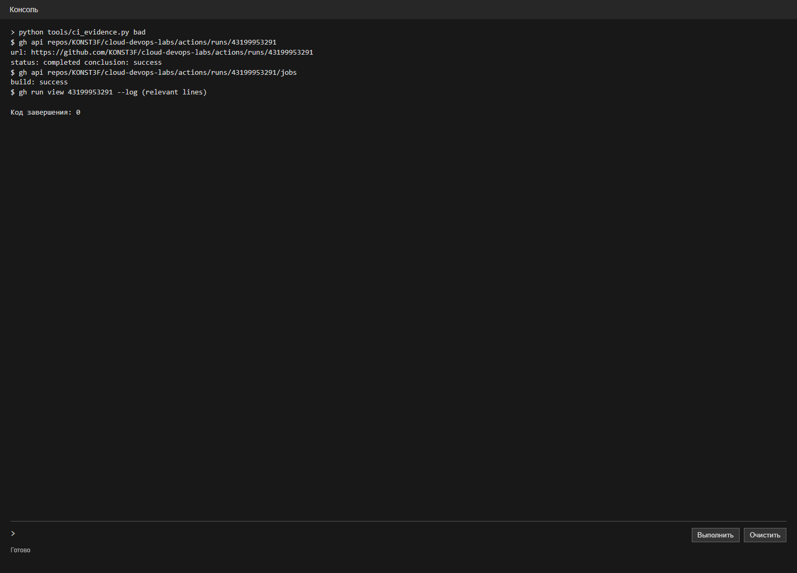
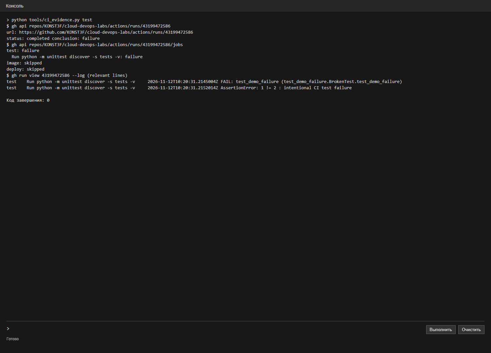
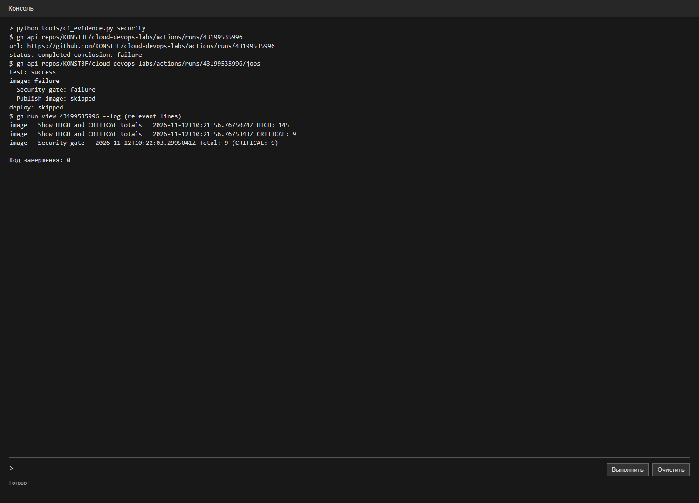
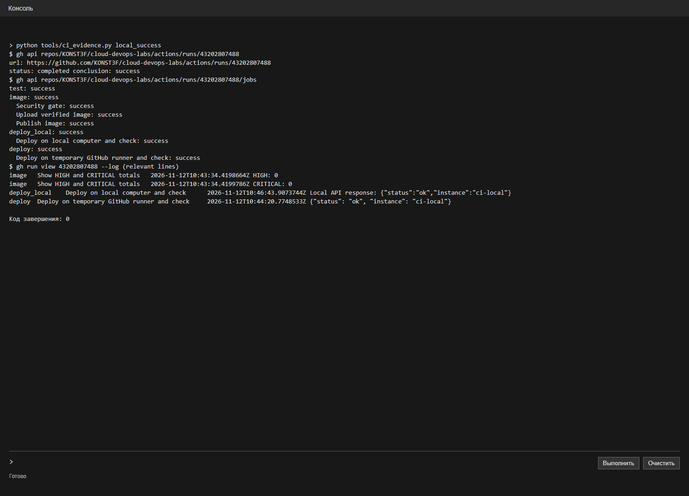
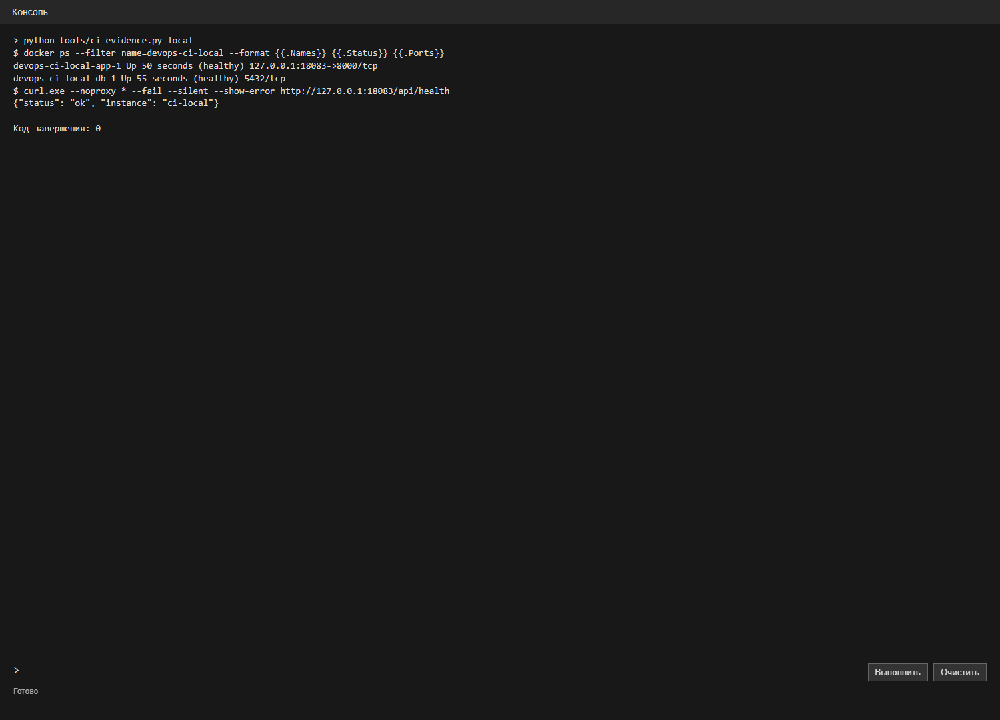

# Лабораторная работа 3. CI/CD

ИСУ 504560, К3239

Для лабы использовал сервис заметок из предыдущих работ. Исходники и отчёт лежат в репозитории [cloud-devops-labs](https://github.com/KONST3F/cloud-devops-labs).

## Плохой пайплайн

[bad-ci.yml](../.github/workflows/bad-ci.yml) просто собирает `Dockerfile.bad`. Проверочный прогон был запущен из ветки `lab3-bad` до переноса файлов в папки. В нём нет тестов и проверки безопасности, зависимости и слои специально не кешируются, а версия runner `ubuntu-latest` и образа `python:3.12` может измениться. Такой пайплайн может собрать образ с ошибкой, потому что проверять код ему нечем.

[Прогон плохого пайплайна](https://github.com/KONST3F/cloud-devops-labs/actions/runs/43199953291) завершился успешно:

## Исправленный пайплайн

В [ci.yml](../.github/workflows/ci.yml) сначала проверяю код и запускаю тесты API, затем собираю Docker-образ с кешем BuildKit и сканирую его Trivy. При CRITICAL проверка завершается с ошибкой и следующие этапы не запускаются. После успешного сканирования образ с тегом коммита публикуется в GitHub Container Registry. Тот же проверенный образ сохраняется как артефакт: runner на моём компьютере загружает его, запускает вместе с PostgreSQL через Compose и проверяет запросом к API.

Версии Actions зафиксированы по SHA, в Dockerfile и Compose указаны версии образов. Для публикации используется `GITHUB_TOKEN`, а пароль базы хранится в GitHub Secrets как `CI_DB_PASSWORD`. На локальном этапе образ передаётся через артефакт, поэтому входить в GHCR на компьютере не нужно. В файлы репозитория пароль не добавлял.

## Проверка тестов

Специально добавил падающий тест и отправил коммит. [Прогон](https://github.com/KONST3F/cloud-devops-labs/actions/runs/43199472586) остановился на `test`: сборка образа и развёртывание были пропущены. После проверки удалил намеренно сломанный тест.

## Проверка безопасности

Сначала сканировал прежний образ на `python:3.12.8-slim-bookworm`. Trivy нашёл CRITICAL, security gate завершился с ошибкой, а публикация и развёртывание были пропущены. Затем перешёл на `python:3.12.16-alpine3.24` и обновил пакеты Alpine при сборке.

| Образ | HIGH | CRITICAL |
| --- | ---: | ---: |
| Старый Debian-образ | 145 | 9 |
| Обновлённый Alpine-образ | 0 | 0 |

Числа относятся к сканированиям 12 ноября 2026 года и могут измениться при обновлении базы уязвимостей. [Прогон со старым образом](https://github.com/KONST3F/cloud-devops-labs/actions/runs/43199535996), [прогон с обновлённым](https://github.com/KONST3F/cloud-devops-labs/actions/runs/43200383287).

## Успешный прогон и проверка сервиса

Сначала локальный деплой остановился на входе Docker в GHCR. Я изменил передачу образа: после сканирования сохраняю его в артефакт, а локальный runner загружает этот же образ. Публикация в GHCR по-прежнему выполняется на GitHub.

В [последнем прогоне](https://github.com/KONST3F/cloud-devops-labs/actions/runs/43202807488) тесты, сборка, Trivy, публикация и локальный деплой завершились успешно. Одноразовый runner запустил приложение с базой на моём компьютере; запрос к `http://127.0.0.1:18083/api/health` вернул `{"status":"ok","instance":"ci-local"}`. После задания runner автоматически удалил свою регистрацию.

Ранее отдельно проверял ручной локальный запуск из того же Dockerfile:

После переноса файлов в папки пути в workflow обновлены. Для повторного автоматического деплоя на компьютер нужно включить его в настройках репозитория или выбрать при ручном запуске и подключить runner.
