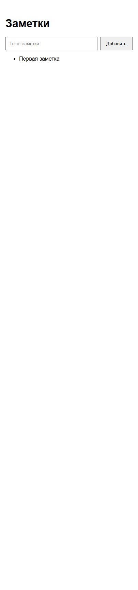

# Лабораторная 0. Свой сервис

ИСУ 504560, К3239

Сервис «Заметки» состоит из страницы на HTML и JavaScript, сервера на Python и базы PostgreSQL. На странице можно добавить заметку и посмотреть сохранённые записи.

Страница отправляет текст на `POST /api/notes`, а список получает через `GET /api/notes`. Сервер сохраняет записи в PostgreSQL. Инструкция запуска и файлы проекта находятся в [README](README.md).

## Проверка

Запустил PostgreSQL и приложение, открыл страницу, добавил заметку «Первая заметка» и обновил страницу. Заметка осталась в списке.

[Репозиторий проекта](https://github.com/KONST3F/cloud-devops-labs)
