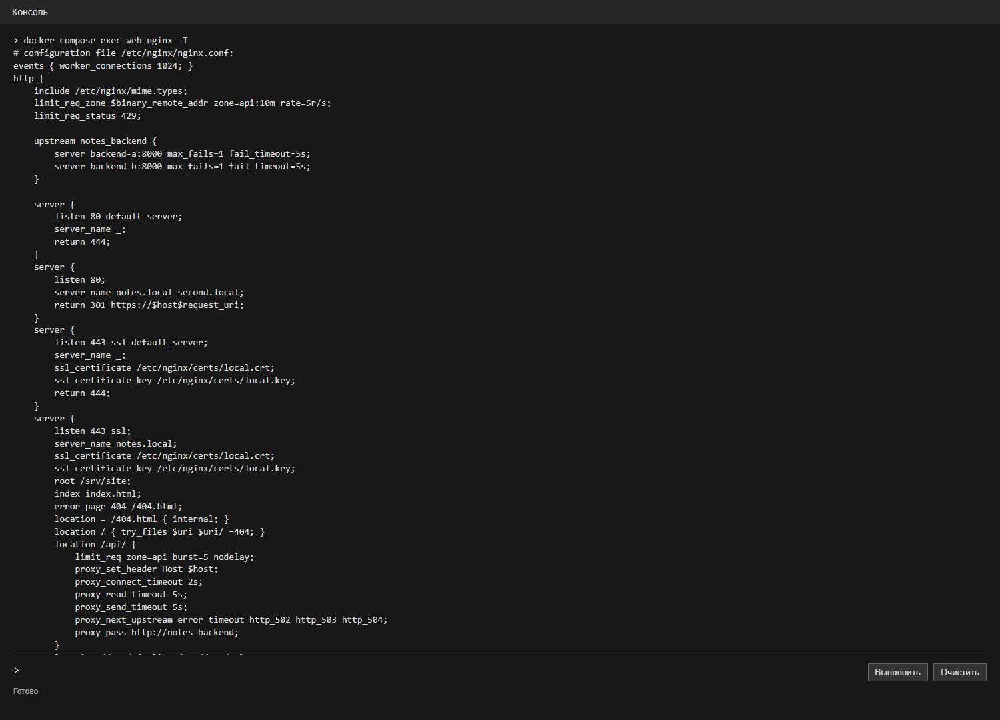
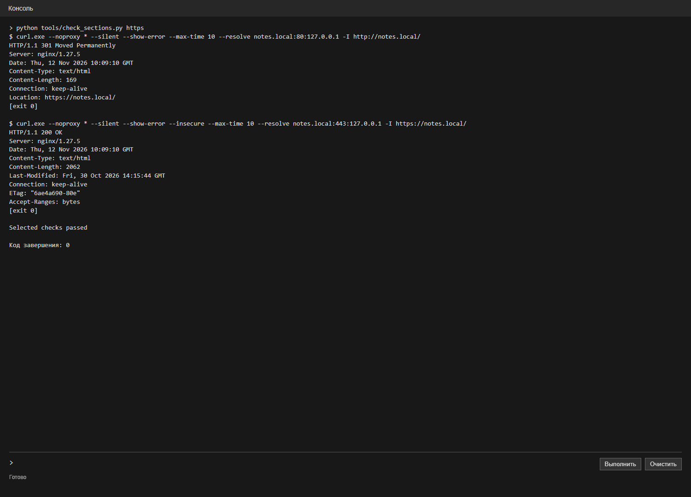
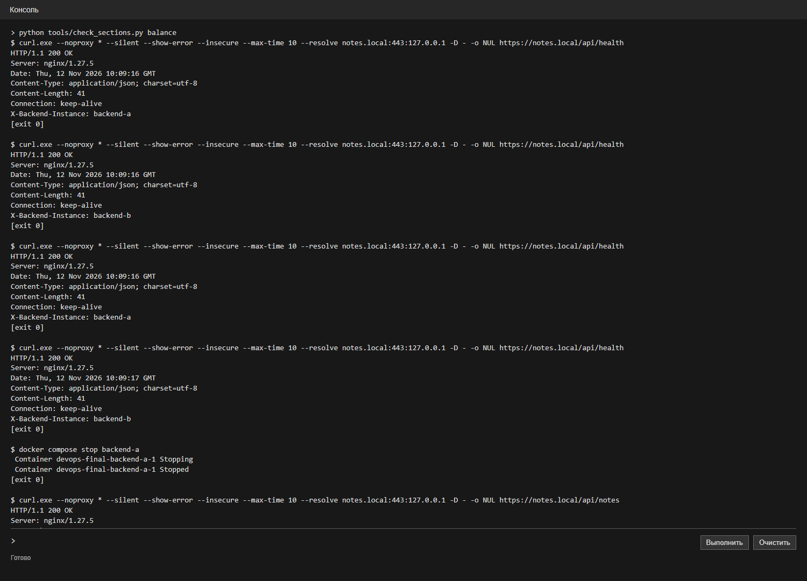
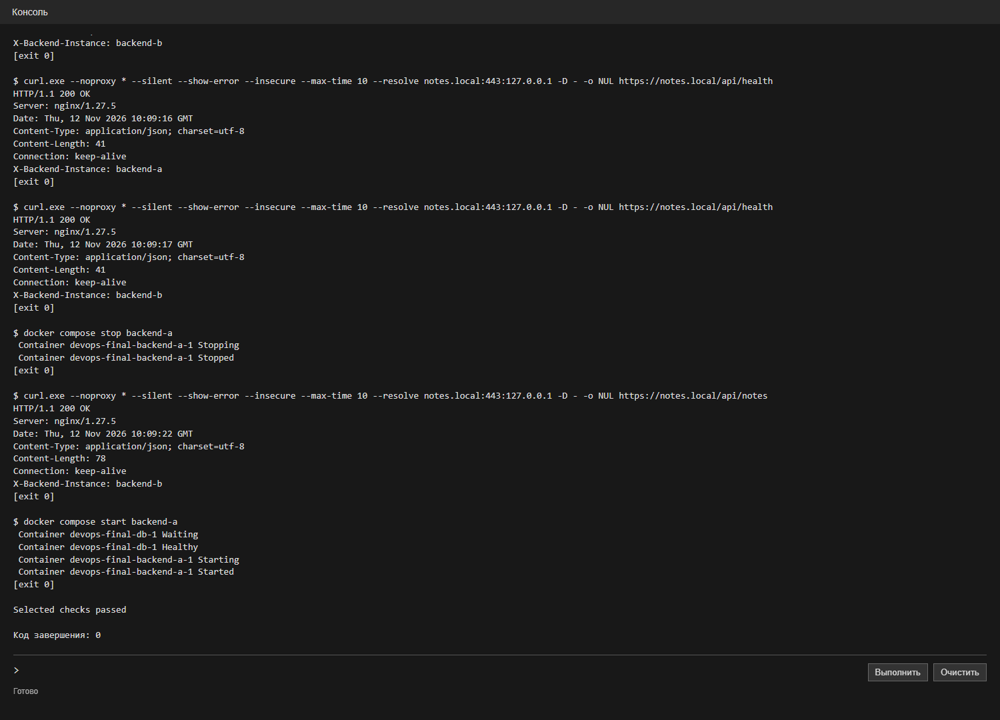
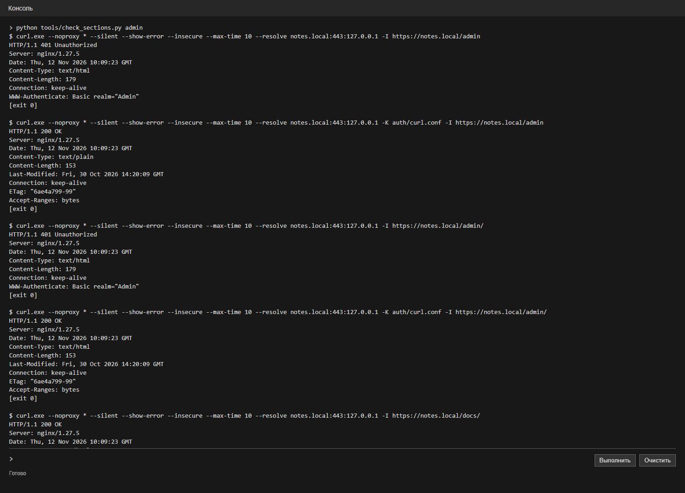
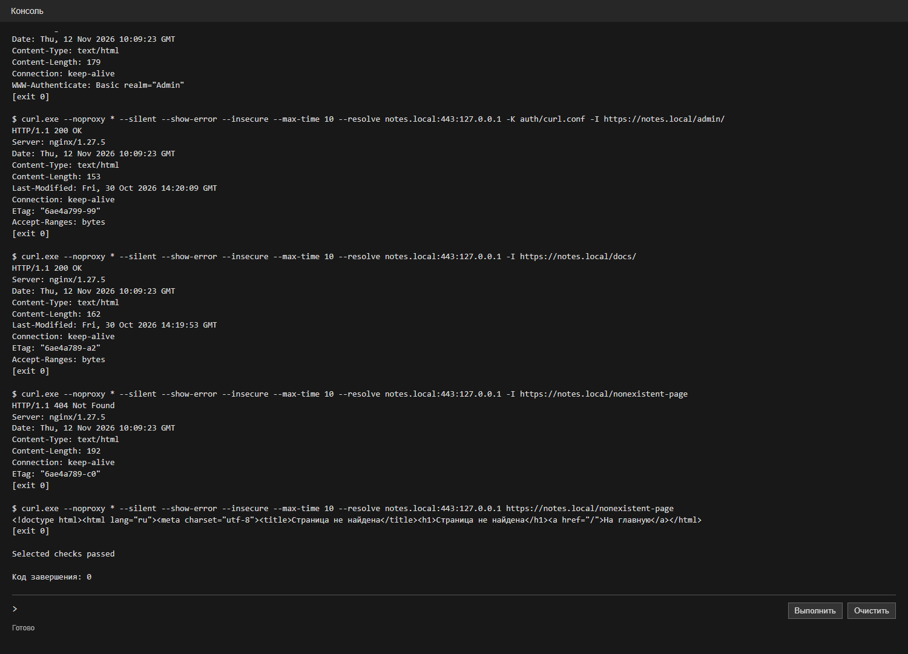
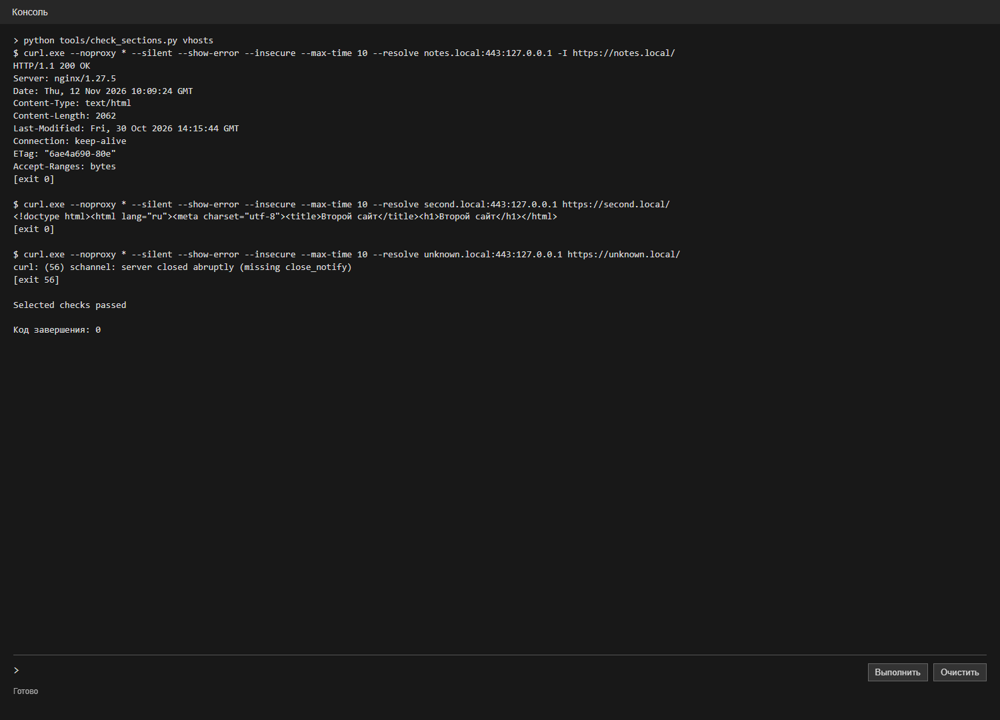
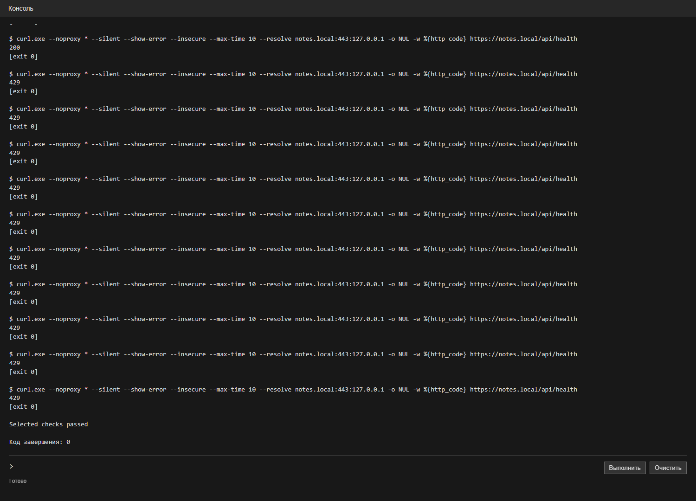
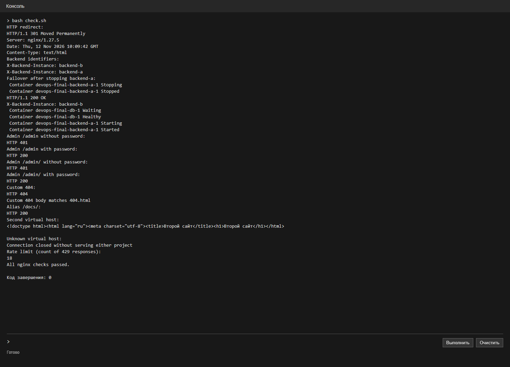

# Лабораторная работа 1. Nginx

ИСУ 504560, К3239

Для работы взял сервис заметок из лабы 0. Страница отправляет запросы к Python-серверу, записи хранятся в PostgreSQL. Nginx отдаёт страницу и проксирует запросы к двум экземплярам сервера. Запуск описан в [README](README.md).

## Конфигурация

В `upstream` указал `backend-a` и `backend-b`. Для `/api/` настроил проксирование, таймауты и ограничение запросов. `/docs/` отдаётся через `alias`, `/admin` и `/admin/` защищены Basic Auth. На `second.local` находится вторая страница, для неизвестных имён настроен сервер по умолчанию. Для HTTP сделал перенаправление на HTTPS. Файлы с паролями и ключом сертификата создаются локально.

Проверил применённую конфигурацию командой `nginx -T`:



Полный [nginx.conf](nginx.conf):

```nginx
events { worker_connections 1024; }
http {
    include /etc/nginx/mime.types;
    limit_req_zone $binary_remote_addr zone=api:10m rate=5r/s;
    limit_req_status 429;

    upstream notes_backend {
        server backend-a:8000 max_fails=1 fail_timeout=5s;
        server backend-b:8000 max_fails=1 fail_timeout=5s;
    }

    server {
        listen 80 default_server;
        server_name _;
        return 444;
    }
    server {
        listen 80;
        server_name notes.local second.local;
        return 301 https://$host$request_uri;
    }
    server {
        listen 443 ssl default_server;
        server_name _;
        ssl_certificate /etc/nginx/certs/local.crt;
        ssl_certificate_key /etc/nginx/certs/local.key;
        return 444;
    }
    server {
        listen 443 ssl;
        server_name notes.local;
        ssl_certificate /etc/nginx/certs/local.crt;
        ssl_certificate_key /etc/nginx/certs/local.key;
        root /srv/site;
        index index.html;
        error_page 404 /404.html;
        location = /404.html { internal; }
        location / { try_files $uri $uri/ =404; }
        location /api/ {
            limit_req zone=api burst=5 nodelay;
            proxy_set_header Host $host;
            proxy_connect_timeout 2s;
            proxy_read_timeout 5s;
            proxy_send_timeout 5s;
            proxy_next_upstream error timeout http_502 http_503 http_504;
            proxy_pass http://notes_backend;
        }
        location /docs/ { alias /srv/docs/; }
        location = /admin {
            auth_basic "Admin";
            auth_basic_user_file /etc/nginx/auth/htpasswd;
            alias /srv/admin/index.html;
        }
        location /admin/ {
            auth_basic "Admin";
            auth_basic_user_file /etc/nginx/auth/htpasswd;
            alias /srv/admin/;
            index index.html;
        }
    }
    server {
        listen 443 ssl;
        server_name second.local;
        ssl_certificate /etc/nginx/certs/local.crt;
        ssl_certificate_key /etc/nginx/certs/local.key;
        root /srv/second;
        location / { try_files $uri $uri/ =404; }
    }
}
```

## Проверки

Проверил синтаксис nginx:


HTTP возвращает 301 и перенаправляет на HTTPS; запрос по HTTPS возвращает 200. Сертификат самоподписанный, поэтому при проверке использовал `--insecure`, а имена подставил через `--resolve`.



Несколько раз запросил API и посмотрел заголовок `X-Backend-Instance`: ответили оба бэкенда. Затем остановил `backend-a` и повторил запрос. Ответ пришёл от `backend-b`, после чего запустил первый контейнер обратно.





Проверил админку с паролем и без него: без авторизации оба адреса возвращают 401, с авторизацией 200. Для `/docs/` получил 200, для отсутствующей страницы 404; содержимое ответа совпало с моей страницей ошибки.





У второго хоста открывается своя страница, а для неизвестного имени соединение закрывается. При серии быстрых запросов к API появились ответы 429.





Запустил общую проверку `bash check.sh`. Полный вывод:

```text
HTTP redirect:
HTTP/1.1 301 Moved Permanently
Server: nginx/1.27.5
Date: Thu, 12 Nov 2026 10:09:42 GMT
Content-Type: text/html
Backend identifiers:
X-Backend-Instance: backend-b
X-Backend-Instance: backend-a
Failover after stopping backend-a:
 Container devops-final-backend-a-1 Stopping 
 Container devops-final-backend-a-1 Stopped 
HTTP/1.1 200 OK
X-Backend-Instance: backend-b
 Container devops-final-db-1 Waiting 
 Container devops-final-db-1 Healthy 
 Container devops-final-backend-a-1 Starting 
 Container devops-final-backend-a-1 Started 
Admin /admin without password:
HTTP 401
Admin /admin with password:
HTTP 200
Admin /admin/ without password:
HTTP 401
Admin /admin/ with password:
HTTP 200
Custom 404:
HTTP 404
Custom 404 body matches 404.html
Alias /docs/:
HTTP 200
Second virtual host:
<!doctype html><html lang="ru"><meta charset="utf-8"><title>Второй сайт</title><h1>Второй сайт</h1></html>

Unknown virtual host:
Connection closed without serving either project
Rate limit (count of 429 responses):
18
All nginx checks passed.

Код завершения: 0
```



Итог: nginx отдаёт страницы, защищает админку и перенаправляет API на работающий бэкенд.
