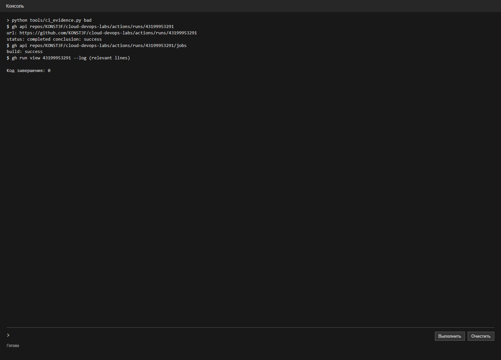
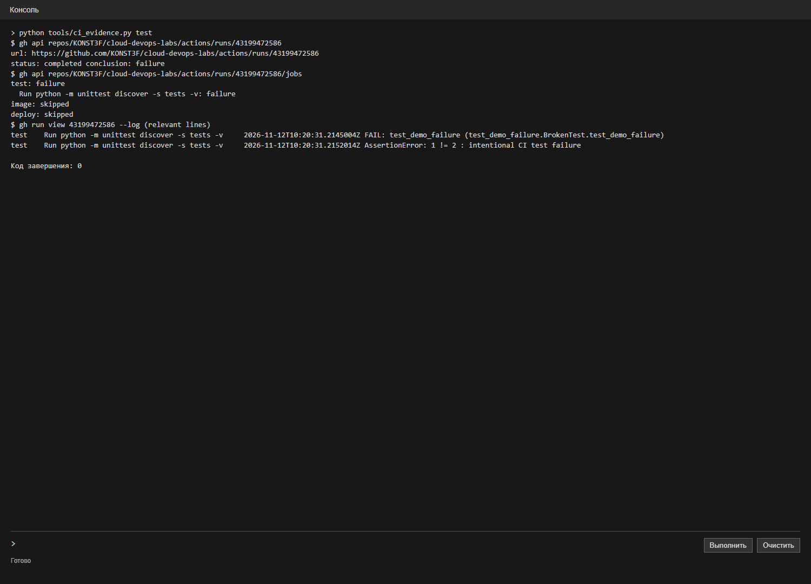
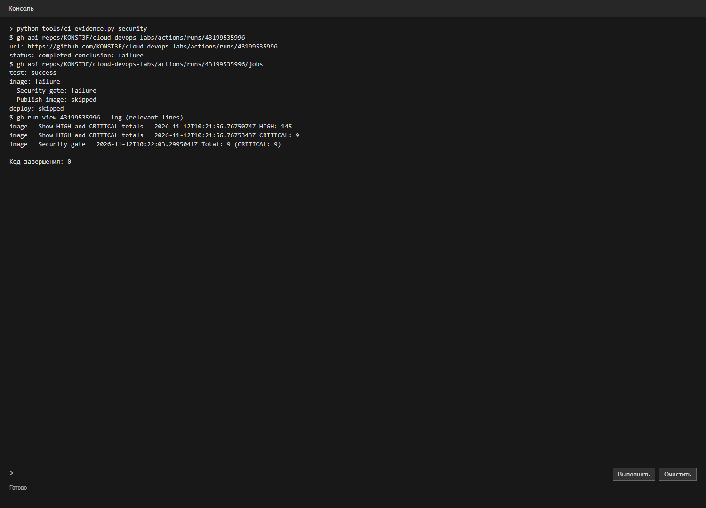
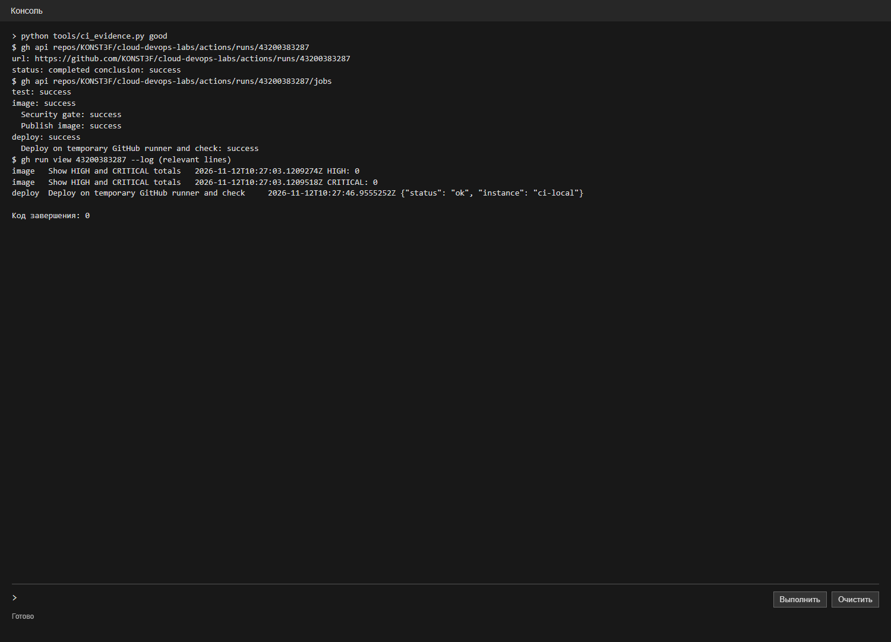
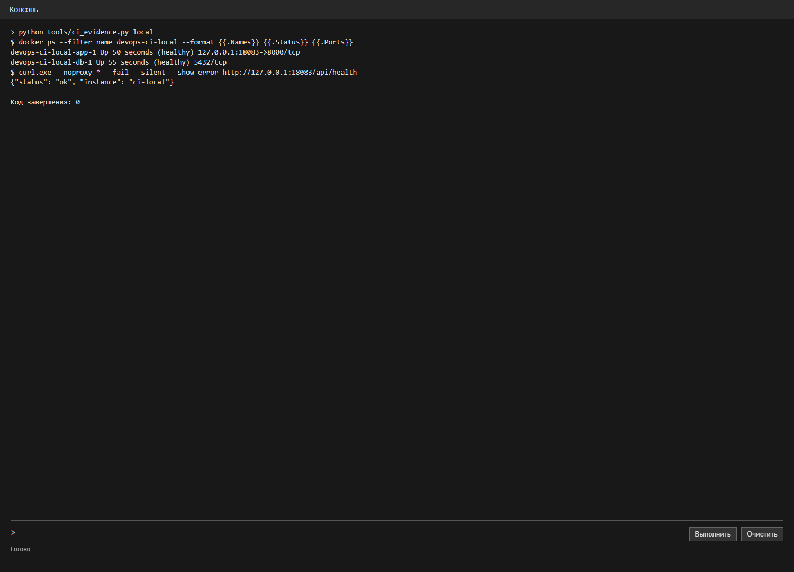

# Лабораторная работа 3. CI/CD

ИСУ 504560, К3239

Для лабы использовал сервис заметок из предыдущих работ. Исходники и отчёт лежат в ветке `lab3-ci` репозитория [cloud-devops-labs](https://github.com/KONST3F/cloud-devops-labs/tree/lab3-ci).

## Плохой пайплайн

[bad-ci.yml](.github/workflows/bad-ci.yml) запускается в ветке `lab3-bad` и просто собирает `Dockerfile.bad`. В нём нет тестов и проверки безопасности, зависимости и слои специально не кешируются, а версия runner `ubuntu-latest` и образа `python:3.12` может измениться. Такой пайплайн может собрать образ с ошибкой, потому что проверять код ему нечем.

[Прогон плохого пайплайна](https://github.com/KONST3F/cloud-devops-labs/actions/runs/43199953291) завершился успешно:

## Исправленный пайплайн

В [ci.yml](.github/workflows/ci.yml) сначала проверяю код и запускаю тесты API, затем собираю Docker-образ с кешем BuildKit и сканирую его Trivy. При CRITICAL проверка завершается с ошибкой и следующие этапы не запускаются. После успешного сканирования образ с тегом коммита публикуется в GitHub Container Registry, затем запускается вместе с PostgreSQL через Compose и проверяется запросом к API.

Версии Actions зафиксированы по SHA, в Dockerfile и Compose указаны версии образов. Для публикации используется `GITHUB_TOKEN`, а пароль базы хранится в GitHub Secrets как `CI_DB_PASSWORD`. В файлы репозитория пароль не добавлял.

## Проверка тестов

Специально добавил падающий тест и отправил коммит. [Прогон](https://github.com/KONST3F/cloud-devops-labs/actions/runs/43199472586) остановился на `test`: сборка образа и развёртывание были пропущены. После проверки удалил намеренно сломанный тест.

## Проверка безопасности

Сначала сканировал прежний образ на `python:3.12.8-slim-bookworm`. Trivy нашёл CRITICAL, security gate завершился с ошибкой, а публикация и развёртывание были пропущены. Затем перешёл на `python:3.12.16-alpine3.24` и обновил пакеты Alpine при сборке.

| Образ | HIGH | CRITICAL |
| --- | ---: | ---: |
| Старый Debian-образ | 145 | 9 |
| Обновлённый Alpine-образ | 0 | 0 |

Числа относятся к сканированиям 12 ноября 2026 года и могут измениться при обновлении базы уязвимостей. [Прогон со старым образом](https://github.com/KONST3F/cloud-devops-labs/actions/runs/43199535996), [прогон с обновлённым](https://github.com/KONST3F/cloud-devops-labs/actions/runs/43200383287).

## Успешный прогон и проверка сервиса

После обновления образа тесты, сканирование и публикация прошли. Пайплайн поднял приложение и базу на временной машине GitHub Actions, а запрос к `/api/health` вернул `{"status": "ok", "instance": "ci-local"}`.

Отдельно собрал тот же Dockerfile и вручную запустил приложение с базой на своём компьютере. Контейнеры были запущены, а `curl` к локальному API вернул `status: ok`.

Автоматический деплой на свой компьютер пока не настроен: автоматическое развёртывание в этом прогоне происходило на временной машине GitHub, которая удаляется после работы. Это ограничение нужно устранить или согласовать с преподавателем, если требуется именно автоматический локальный деплой.
